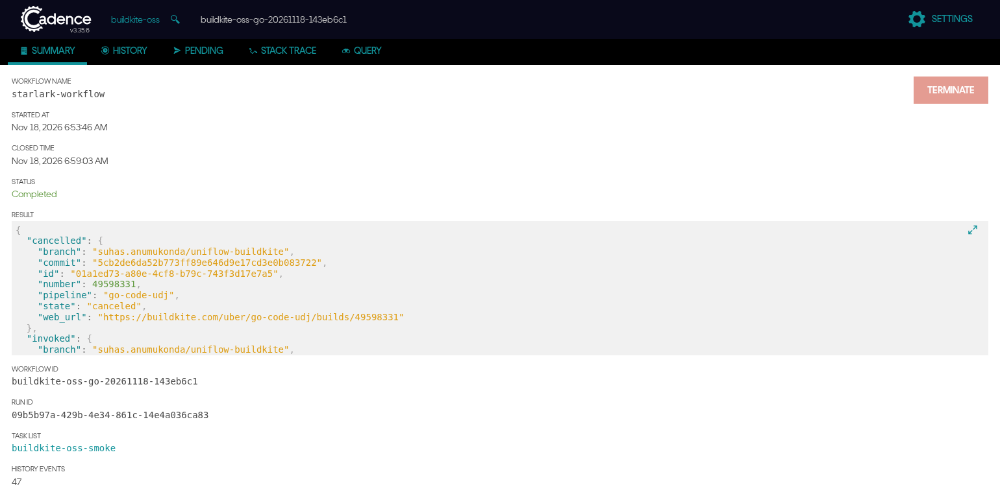
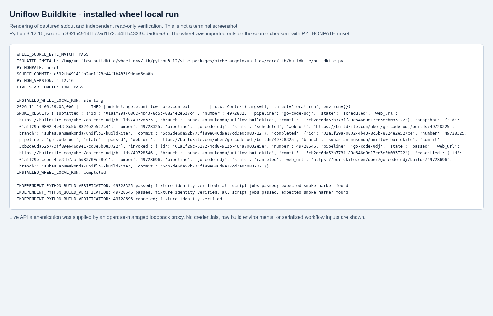

# Buildkite Uniflow OSS smoke evidence

Collected on **November 18, 2026** for
[michelangelo-ai/michelangelo#2444](https://github.com/michelangelo-ai/michelangelo/pull/2444).
This is an evidence-only branch, not part of the source PR's diff.

## Source and environment

- Live implementation: `d3c293ff262151d471fcc6e1511a387ae7191d59`.
- Review head: `447a6577612c7dc16ebcb7c460340020a3128c33`.
  The only intervening change is a required naming annotation on the test
  HTTP handler. All production code is byte-identical to the live-tested tree.
- Go: stock `github.com/michelangelo-ai/michelangelo/go/cmd/worker`, running
  locally with the complete Fx/plugin/activity registrations and a separate
  local Cadence instance. This was not the internal MA worker or a full
  Kubernetes sandbox.
- Python: a locally built `michelangelo-0.13.0-py3-none-any.whl`, installed in
  an isolated Python 3.12 environment. `PYTHONPATH` was cleared, imports were
  verified against the wheel, and the normal `create_context().run()` local
  execution path compiled the workflow before running it.
- An operator-authenticated loopback proxy provided access to the live
  Buildkite API. No credentials were workflow arguments or results.

## Observed results

| Implementation | Submit → get → wait | Invoke | Cancel |
| --- | --- | --- | --- |
| OSS Go / Starlark | [49597966 — passed](https://buildkite.com/uber/go-code-udj/builds/49597966) | [49598182 — passed](https://buildkite.com/uber/go-code-udj/builds/49598182) | [49598331 — canceled](https://buildkite.com/uber/go-code-udj/builds/49598331) |
| Installed-wheel Python local run | [49597323 — passed](https://buildkite.com/uber/go-code-udj/builds/49597323) | [49597585 — passed](https://buildkite.com/uber/go-code-udj/builds/49597585) | [49597813 — canceled](https://buildkite.com/uber/go-code-udj/builds/49597813) |

Each successful job's log contained the expected smoke marker. Independent
read-only checks confirmed terminal states, build identity, exact fixture
revision/configuration, and all seven result field types. The Buildkite jobs
run a pre-existing harmless echo/sleep fixture; the `commit` in each build
snapshot is that job repository's commit, not the OSS implementation commit.

The Go workflow completed with **47 history events** and precisely the seven
expected scheduled activities: three `TriggerBuild`, one `GetBuild`, two
`SensorGetBuild`, and one `CancelBuild`. All activity names are qualified by
the OSS Go package. Submission and cancellation had no activity retry policy.

### Actual Cadence UI



The screenshot is cropped before the serialized workflow input. Workflow:
`buildkite-oss-go-20261118-143eb6c1`; run:
`09b5b97a-429b-4e34-861c-14e4a036ca83`; domain: `buildkite-oss`; task list:
`buildkite-oss-smoke`.

Local UI URL (requires access/port-forwarding to the test host while the
local stack is running):

```text
http://127.0.0.1:18088/domains/buildkite-oss/workflows/buildkite-oss-go-20261118-143eb6c1/09b5b97a-429b-4e34-861c-14e4a036ca83/summary
```

### Captured Python local-run output



This is a rendering of captured stdout, not a screenshot of a terminal.
[Verbatim text](python-local-run.txt) and
[machine-readable verified receipts](smoke-receipts.json) are included.

## Scope of the live proof

The live remote run used Cadence. Temporal behavior and direct bearer-token
transport were exercised in hermetic tests, not against a live Temporal
server or a separately provisioned Buildkite API token. No SDK release or AV
dependency bump was published by these tests.

Only compact results, build links, and selected provenance are published
here. Raw job environments, gateway configuration, credentials, raw workflow
inputs, and temporary smoke scripts are intentionally excluded.
