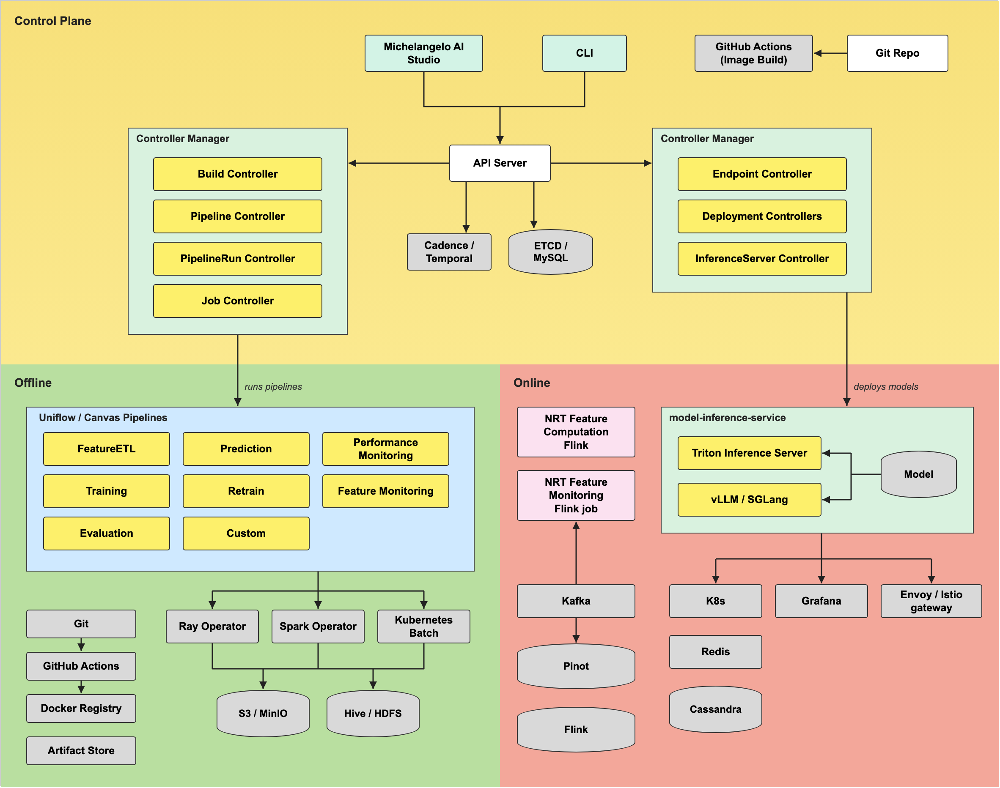

# System Architecture

Michelangelo AI runs on Kubernetes. Everything you create, such as a pipeline, a pipeline run, or an inference server, is stored as a Kubernetes custom resource, and controllers reconcile each one toward its desired state. This page shows how the pieces fit together and which controller owns which resource.

The diagram has three areas: the control plane, the offline side (pipelines, compute, and storage), and the online side (model serving). Some boxes are Michelangelo AI components, and some are external systems a deployment connects to. [Integrations and optional components](#integrations-and-optional-components) lists which is which.

## Control plane

The control plane is what you talk to. It stores resources and runs the controllers that act on them.

- **Michelangelo AI Studio and the CLI** are the clients. They call the Michelangelo AI API server over gRPC. They do not call the Kubernetes API server directly.
- **API server** exposes the gRPC API for each resource kind and persists the resources through Kubernetes. See [API Framework](../operator-guides/api-framework.md).
- **Controller managers** run the controllers that reconcile resources. One group handles pipelines and jobs, and another handles inference servers and deployments.
- **Workflow engine** (Cadence or Temporal) executes the workflows that pipeline runs trigger. The Helm chart can install Cadence or Temporal as an optional subchart, or you can point it at an existing service.
- **Metadata storage** keeps resources in Kubernetes (etcd). The ingester controller also syncs every resource into MySQL for querying. See [Ingester Controller](../operator-guides/components/ingester-configuration.md).

## Offline: pipelines, compute, and storage

When a pipeline run starts, the pipeline run controller coordinates the build and the workflow execution, and the workflow engine runs the pipeline steps. Pipelines are written with [Uniflow](../user-guides/ml-pipelines/running-uniflow.md), Michelangelo AI's Python framework. The diagram shows the common pipeline types: feature ETL, training, evaluation, prediction, retraining, and monitoring, plus custom pipelines.

Pipeline steps run as Ray or Spark jobs on a registered compute cluster:

- **Ray** jobs and clusters are managed through the `RayJob` and `RayCluster` resources and the KubeRay operator.
- **Spark** jobs are managed through the `SparkJob` resource and the Spark operator.
- A scheduler assigns jobs to registered clusters. See [Jobs Overview](../operator-guides/jobs/index.md).

Pipelines read and write data and artifacts in S3-compatible object storage. The local sandbox uses SeaweedFS by default, and a production deployment points `objectStorage.endpoint` at its own S3-compatible store.

## Online: model serving

Serving is managed by the `InferenceServer` and `Deployment` controllers.

- An **InferenceServer** provisions the serving infrastructure on a target cluster. Triton Inference Server is the backend implemented in this repository. Other frameworks plug in through the `Backend` interface (see [Integrate a Custom Backend](../operator-guides/serving/integrate-custom-backend.md)).
- A **Deployment** rolls a model out to an inference server, cluster by cluster. A model-sync sidecar loads and unloads models on the server.

See [Serving Overview](../operator-guides/serving/index.md) for the lifecycle details.

## Custom resources (CRDs)

The API server registers these resource kinds at startup from the protobuf definitions in `proto/api/v2/`. The ingester syncs all of them to MySQL.

| Kind | What it represents | Reconciled by |
|------|--------------------|---------------|
| `Project` | A grouping of ML work, with owner information | No controller; validated by an API hook (`go/components/project/apihook`) |
| `Pipeline` | A pipeline definition | Pipeline controller (`go/components/pipeline`) |
| `Revision` | A versioned snapshot of a resource such as a pipeline | Revision controller (`go/components/revision`) |
| `PipelineRun` | One execution of a pipeline | PipelineRun controller (`go/components/pipelinerun`) |
| `TriggerRun` | A schedule or backfill that starts pipeline runs | TriggerRun controller (`go/components/triggerrun`) |
| `CachedOutput` | Cached output of a pipeline step, used to resume or skip steps | No controller |
| `Cluster` | A registered compute cluster that jobs can run on | Cluster controller (`go/components/jobs/cluster`) |
| `RayCluster` | A Ray cluster | RayCluster controller (`go/components/ray/cluster`) |
| `RayJob` | A Ray job | RayJob controller (`go/components/ray/job`) |
| `SparkJob` | A Spark job | SparkJob controller (`go/components/spark/job`) |
| `Model` | A registered model | No controller; validated by an API hook (`go/components/model/apihook`) |
| `ModelFamily` | A group of related models | No controller |
| `EvaluationReport` | The evaluation results for a model | No controller |
| `InferenceServer` | A serving environment for models | InferenceServer controller (`go/components/inferenceserver`) |
| `Deployment` | A rollout of a model to an inference server | Deployment controller (`go/components/deployment`) |

Kinds with no controller are stored and served by the API server and synced by the ingester, but nothing reconciles them. For the full field definitions, see the `.proto` files in [`proto/api/v2/`](https://github.com/michelangelo-ai/michelangelo/tree/main/proto/api/v2) and the [gRPC reference](../api-reference/index.md).

## Integrations and optional components

The diagram shows a complete production-style deployment. Not everything in it ships with this repository.

- **Installed by the Helm chart:** the API server, controller manager, worker, Envoy, and UI, plus Grafana dashboards, a `ServiceMonitor`, and a `PrometheusRule` for monitoring. The chart can optionally install Cadence or Temporal as a subchart. See [Helm Chart](../operator-guides/helm-chart.md).
- **Supplied by you:** MySQL (or Postgres) for metadata storage, and S3-compatible object storage. The sandbox sets up its own object store (SeaweedFS by default), the Ray and Spark operators, and the other services it needs. See [Sandbox Setup](./sandbox-setup.md).
- **Integrations a deployment may use:** Pinot, Kafka, Cassandra, Redis, and the near-real-time Flink feature jobs shown in the online area, along with Hive/HDFS, Istio, and a Git and image-build pipeline. This repository has no code or chart for them. Treat them as systems you can connect to Michelangelo AI, not as parts it installs.

## Where to go next

- [Core Concepts and Key Terms](./core-concepts-and-key-terms.md): the vocabulary used on this page.
- [Sandbox Setup](./sandbox-setup.md): run the whole control plane on your laptop.
- [Operator Guides](../operator-guides/index.md): deploy and configure each component.
- [Platform Setup](../operator-guides/setup/platform-setup.md): how the server components connect.
- [Jobs Overview](../operator-guides/jobs/index.md) and [Serving Overview](../operator-guides/serving/index.md): the offline and online runtime in depth.
- [Getting Started with ML Pipelines](../user-guides/getting-started/getting-started.md): build and run your first pipeline.
