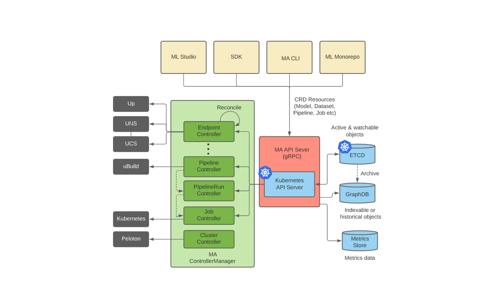
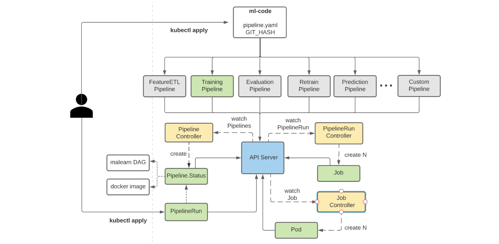

# Michelangelo AI API Framework

The Michelangelo AI API Framework abstracts Kubernetes CRDs through a gRPC API server. It is the control plane component that the `ma` CLI, UI, worker, and SDK all talk to. This guide covers the architecture of that component and how its parts fit together for operators deploying or maintaining Michelangelo AI.

**Audience**: Platform operators and contributors who need to understand how the API layer is structured.

**Prerequisites**: Familiarity with Kubernetes CRDs, gRPC, and the Michelangelo AI control plane (see [Platform Setup](setup/platform-setup.md)).

## Architecture

Michelangelo AI defines the APIs using Protobuf as the IDL and the
clients like UI, CLI and SDK can access the API via gRPC or
HTTP/JSON (the UI reaches the API server through an Envoy proxy that
transcodes proto3 JSON to gRPC). Michelangelo AI provides Python and
Golang bindings in this repository. Any other language bindings
supported by gRPC should work as well.

For detailed Michelangelo AI API definition, see the protobuf definitions in `proto/api/`.

Figure below shows the high-level architecture of Michelangelo AI API
framework that consists of the following components:

### API Servers

**Kubernetes API Server:** A REST service that provides the standard
methods for each CRD type (API resource type). Controllers monitor the
creations / modifications of the CRD objects through the Kubernetes
API server. Michelangelo AI users cannot directly call Kubernetes API
server. Instead, they have to use Michelangelo AI API server (gRPC) or
Michelangelo AI CLI(ma) to use Michelangelo AI APIs.

**Michelangelo AI API Server:** A gRPC server. For standard declarative
API resources, Michelangelo AI API server is a gRPC to REST proxy. The
APIs that do not fit into the declarative design are implemented in
the Michelangelo AI API server itself, through its API handlers and
hooks (for example the metadata-storage and blob-storage handlers in
`go/api/handler/`).

The Kubernetes API server is your cluster's own control plane
component. The Michelangelo AI API server is deployed separately as
the chart's `apiserver` Deployment and is stateless, so you can run
multiple replicas for high availability or scalability.

### ETCD
ETCD is a strongly consistent key-value store that supports lock,
leader election, and watching changes.
 
All the API resources (CRD objects) are stored in a global ETCD
cluster. With API Hooks, API developers may store some of the API
resource data into other storage systems (e.g. mysql, S3), while
keeping the metadata in ETCD.

### Controller Manager
Each controller monitors one API resource type. It’s a
controller’s job to ensure that, for any given object, the actual
state of the world matches the desired state (specification) in the
object.

Currently, all the Michelangelo AI controllers are in a single process,
i.e. Michelangelo AI Controller Manager. There will be multiple
controller manager instances deployed into different availability
zones for high availability. When leader election is enabled
(`controllermgr.leaderElection` in the Helm chart, off by default), only one
instance acts as the leader at any time and the others are followers.

Controller Manager uses ETCD to do the leader election (through
Kubernetes API server). Controller Manager is based on the Kubernetes open-source
framework, i.e. `controller-runtime`.

Figure below shows how different ML pipelines can be managed and
executed using the Michelangelo AI API Framework.

