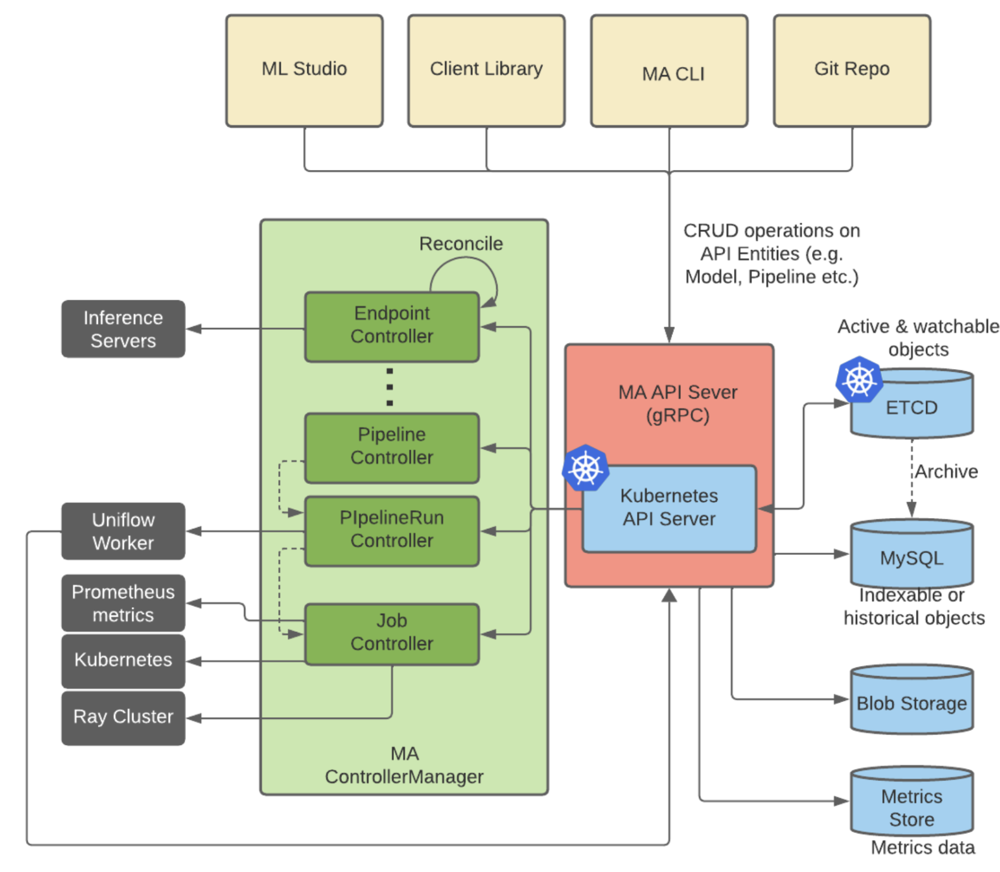

# Platform Setup Guide

This guide describes how to configure **Michelangelo AI server components** in a Kubernetes cluster. It focuses on the **configuration surfaces** (Helm values, the ConfigMaps the chart renders from them, and key parameters). The chart lives at `helm/michelangelo`; see the [Helm Chart guide](../helm-chart.md) for installation.

## Overview

Michelangelo AI consists of four core server components:

1. **API Server** – Central gRPC API
2. **Controller Manager** – Kubernetes controllers
3. **Worker** – Workflow execution (Temporal workers + compute integration)
4. **UI + Envoy** – Frontend and proxy

Each component exposes server-side configuration through a ConfigMap that the Helm chart renders from your values.

This document explains:

* Where each component's configuration lives
* What fields can be customized
* What each field means
* How to apply changes using Helm values

## Michelangelo AI Service architecture diagram

The following diagram shows the relationship between each of the services in Michelangelo AI eco-system.



## Server Configuration

## API Server Configuration

### **Key Fields**

```yaml
apiserver:
  yarpc:
    host: 0.0.0.0
    port: 15566
  k8s:
    qps: 300
    burst: 600
  crdSync:
    enableCRDUpdate: true
    skipIncompatibleCheck: false

metadataStorage:
  enableMetadataStorage: false
```

The chart renders this from the following Helm values (`skipIncompatibleCheck` is read by the apiserver but is not exposed as a chart value):

| Helm value | Default |
| ----- | ----- |
| `apiserver.port` | `15566` |
| `apiserver.k8s.qps` / `apiserver.k8s.burst` | `300` / `600` |
| `apiserver.crdSync.enableUpdate` | `true` |
| `apiserver.metadataStorage.enable` | `false` |

### **Field Explanations**

| Field | Description |
| ----- | ----- |
| `yarpc.host/port` | gRPC bind address + port |
| `apiserver.k8s.qps/burst` | Throttling limits for Kubernetes API calls |
| `metadataStorage.enableMetadataStorage` | Enables metadata persistence |
| `enableCRDUpdate` | Controls whether CRDs can be sync'd |
| `skipIncompatibleCheck` | Skips incompatible CRD change validation (use only during major migrations) |

## Controller Manager Configuration

### **Key Fields**

```yaml
controllermgr:
  metricsBindAddress: ":8091"
  healthProbeBindAddress: ":8081"
  leaderElection: false
  leaderElectionID: decaf1259.michelangelo.uber.com

controllers:
  rayCluster:
    k8sQps: 300
    k8sBurst: 600

minio:
  awsRegion: us-east-1
  awsAccessKeyId: ${AWS_ACCESS_KEY_ID}
  awsSecretAccessKey: ${AWS_SECRET_ACCESS_KEY}
  awsEndpointUrl: s3.amazonaws.com
  secure: true

workflowClient:
  service: temporal-frontend
  host: temporal.your-domain.com:7233
  transport: grpc
  domain: uniflow
```

Helm values: `controllermgr.metricsPort` (`8091`), `controllermgr.healthPort` (`8081`), `controllermgr.leaderElection`, `controllermgr.leaderElectionID`, `controllermgr.controllers.rayCluster.qps/burst`, `objectStorage.*`, and `workflow.engine/endpoint/domain`.

### **Field Explanations**

| Field | Description |
| ----- | ----- |
| `metricsBindAddress` | Controller metrics port |
| `healthProbeBindAddress` | Health check port |
| `leaderElection` | Enable for production HA |
| `minio.*` | S3 / MinIO backend configuration |
| `workflowClient.*` | Temporal client configuration |
| `controllers.*` | Each controller components' configuration |

## Worker Configuration

### **Key Fields**

```yaml
worker:
  address: michelangelo-apiserver:15566
  maApiServiceName: ma-apiserver

logging:
  level: info
  development: true
  encoding: console

workflow-engine:
  host: temporal.your-domain.com:7233
  transport: grpc
  provider: temporal
  workers:
    - domain: uniflow
      taskList: default
  client:
    domain: uniflow
```

The chart sets `worker.address` to the in-cluster API server Service and port (`apiserver.port`). The worker's Go config also accepts `worker.useTLS`, which the chart does not render. Worker logging is set with `worker.logging.*`, and the task lists with `workflow.taskLists` (defaults: `default`, `trigger_run`, `pipeline_run` (deprecated), `notification_worker`).

### **Field Explanations**

| Field | Description |
| ----- | ----- |
| `worker.address` | API server endpoint used by workers |
| `workflow-engine.host` | Temporal endpoint |
| `workers[].taskList` | Worker task list to poll |
| `client.domain` | Temporal workflow domain |

## UI & Envoy Configuration

### **Envoy Proxy**

The chart renders the Envoy ConfigMap (`helm/michelangelo/templates/core/envoy-configmap.yaml`). It runs the gRPC-JSON transcoder, so the browser UI exchanges proto3 JSON with Envoy and Envoy talks gRPC to the API server. Key settings:

```yaml
static_resources:
  listeners:
    - address:
        socket_address: { address: 0.0.0.0, port_value: 8081 }

  clusters:
    - name: michelangelo-apiserver
      load_assignment:
        endpoints:
          - lb_endpoints:
              - endpoint:
                  address:
                    socket_address:
                      address: michelangelo-apiserver
                      port_value: 15566
```

Helm values: `envoy.port` (listener, `8081`), `envoy.corsOrigins` (CORS origin regex), `apiserver.port` (upstream port). See [Deploying Michelangelo AI UI](../ui/deploying-michelangelo-ui.md) for details.

### **Public UI Config**

**ConfigMap:**

```yaml
config.json: |
  {
    "apiBaseUrl": "https://michelangelo-envoy.<your-domain>"
  }
```

Helm value: `ui.apiBaseUrl` (required when `ui.enabled=true`; derived from the first `envoy.ingress` host if left empty).

## Environment Overrides / Domain Settings

You must customize domain-specific values in your Helm values:

| Location | Fields to Update |
| ----- | ----- |
| Worker config | `workflow.endpoint`, `workflow.domain`, `workflow.taskLists` |
| UI Public Config | `ui.apiBaseUrl` |
| Envoy Config | `envoy.corsOrigins` (the API cluster hostname is derived from the release) |
| Ingress | `apiserver.ingress.hosts`, `ui.ingress.hosts`, `envoy.ingress.hosts` |
| Controller Manager | `objectStorage.region`, `objectStorage.endpoint`, `workflow.endpoint` |

## Object Store Configuration

Object storage (MinIO / S3) is used by Michelangelo AI for artifacts and metadata.

## Controller Manager Object Store Settings

These live in the controller manager ConfigMap (and the worker ConfigMap), rendered from the chart's `objectStorage.*` values:

```yaml
minio:
  awsRegion: us-east-1                  # objectStorage.region
  awsAccessKeyId: ${AWS_ACCESS_KEY_ID}          # from the object-storage Secret
  awsSecretAccessKey: ${AWS_SECRET_ACCESS_KEY}  # from the object-storage Secret
  awsEndpointUrl: s3.amazonaws.com      # objectStorage.endpoint
  secure: true                          # objectStorage.secure
```

### **Fields**

* `awsRegion` – The AWS region of your S3 bucket (`objectStorage.region`).
* `awsEndpointUrl` – S3 endpoint (`s3.amazonaws.com` or regional endpoint) (`objectStorage.endpoint`, required).
* `awsAccessKeyId` / `awsSecretAccessKey` – Injected as environment variables from the chart-managed Secret, or from your own Secret via `objectStorage.existingSecret`. Do not hardcode keys in values files.
* `secure` – Use TLS to the endpoint (`objectStorage.secure`). Set `false` only for an in-cluster object store without TLS (MinIO, SeaweedFS).

### **Storage Setup Checklist**

* Provide credentials through `objectStorage.accessKeyId` / `secretAccessKey` or `objectStorage.existingSecret` for pods that need S3 access.
* Verify **region and endpoint** in the rendered ConfigMap match your S3 setup.
* Test connectivity from worker/controller pods to the bucket.

## Workflow Engine Configuration (Temporal/Cadence)

Michelangelo AI uses a workflow engine (Temporal or Cadence) for orchestrating workflows. The chart's `workflow.engine` value selects `cadence` (the default, used in the sandbox) or `temporal`.

## Controller Manager Workflow Client

From `helm/michelangelo/templates/core/controllermgr-configmap.yaml` (rendered from `workflow.engine`, `workflow.endpoint`, `workflow.domain`):

```yaml
workflowClient:
  service: temporal-frontend    # Temporal service name
  host: temporal.your-domain.com:7233  # Temporal endpoint
  transport: grpc               # Transport protocol
  domain: uniflow               # Temporal domain
```

### **Fields**

* `service` – Workflow engine frontend service name (`temporal-frontend` / `cadence-frontend`).
* `host` – Full endpoint (host:port).
* `transport` – Typically `grpc`.
* `domain` – Temporal domain (or Cadence domain) to target.

## Worker Workflow Engine Settings

From `helm/michelangelo/templates/core/worker-configmap.yaml`:

```yaml
workflow-engine:
  host: temporal(/cadence).your-domain.com:7233
  transport: grpc
  provider: temporal/cadence
  workers:
    - domain: uniflow
      taskList: default
  client:
    domain: uniflow
```

### Fields

* `provider` – `temporal` or `cadence`, set from `workflow.engine`.
* `host` – Temporal/Cadence endpoint.
* `workers[].domain` – Domain where worker polls for tasks.
* `workers[].taskList` – Task list (queue) used for workflow tasks.
* `client.domain` – Client domain for starting workflows.

### Temporal Setup

* Ensure Temporal is accessible at the configured endpoint.
* Create the domain or namespace named by `workflow.domain` out-of-band; the chart does not register domains or namespaces.
* Task lists come from `workflow.taskLists` (the worker polls each one).

---

## Related

- [Network & Ingress Configuration](network.md)
- [Monitoring & Observability](../operations/monitoring.md)
- [Authentication](authentication.md)
- [Register a Compute Cluster](register-a-compute-cluster-to-michelangelo-control-plane.md)
